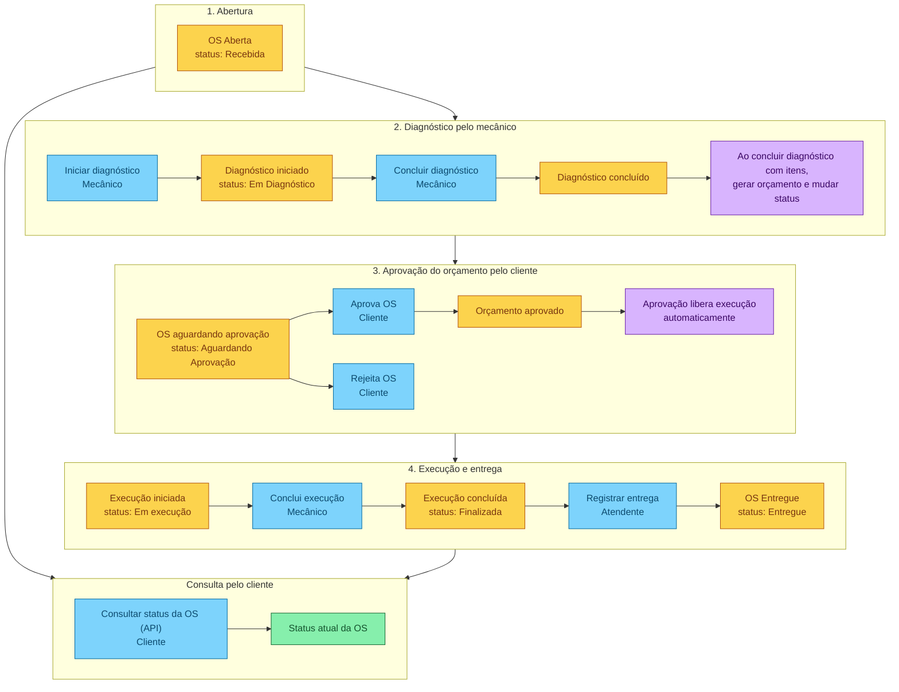

# Event Storming — Acompanhamento da Ordem de Serviço

Quadro da imagem `acompanhamento-os.png`.

Legenda: azul é comando, laranja é evento, roxo é política e verde é modelo de leitura. O ator fica no post-it amarelo do comando.



## Ciclo de status

```
Recebida → Em Diagnóstico → Aguardando Aprovação → Em execução → Finalizada → Entregue
```

`Rejeita OS` parte de Aguardando Aprovação. O quadro não desenha o evento seguinte a essa rejeição.

| Tipo | Rótulo | Ator | Encadeamento |
|---|---|---|---|
| Evento | OS Aberta (status: Recebida) | | → Iniciar diagnóstico |
| Comando | Iniciar diagnóstico | Mecânico | → Diagnóstico iniciado (status: Em Diagnóstico) |
| Evento | Diagnóstico iniciado (status: Em Diagnóstico) | | → Concluir diagnóstico |
| Comando | Concluir diagnóstico | Mecânico | → Diagnóstico concluído |
| Evento | Diagnóstico concluído | | dispara a política de orçamento |
| Política | Ao concluir diagnóstico com itens, gerar orçamento e mudar status | | → OS aguardando aprovação (status: Aguardando Aprovação) |
| Evento | OS aguardando aprovação (status: Aguardando Aprovação) | | → Aprova OS ou Rejeita OS |
| Comando | Aprova OS | Cliente | → Orçamento aprovado |
| Evento | Orçamento aprovado | | dispara a liberação da execução |
| Política | Aprovação libera execução automaticamente | | → Execução iniciada (status: Em execução) |
| Comando | Rejeita OS | Cliente | sem evento seguinte no quadro |
| Evento | Execução iniciada (status: Em execução) | | → Conclui execução |
| Comando | Conclui execução | Mecânico | → Execução concluída (status: Finalizada) |
| Evento | Execução concluída (status: Finalizada) | | → Registrar entrega |
| Comando | Registrar entrega | Atendente | → OS Entregue (status: Entregue) |
| Evento | OS Entregue (status: Entregue) | | fim do ciclo |

## Consulta

O cliente consulta o andamento em qualquer ponto do ciclo desenhado no quadro. A leitura devolve o status atual.

| Tipo | Rótulo | Ator | Encadeamento |
|---|---|---|---|
| Comando | Consultar status da OS (API) | Cliente | lê o status atual; o quadro liga Recebida, Em execução, Finalizada e Entregue a esta consulta |
| Modelo de leitura | Status atual da OS | | resultado da consulta |
