# Event Storming — Criação da Ordem de Serviço

Quadro da imagem `criacao-os.png`.

Legenda: azul é comando, laranja é evento, roxo é política e verde é modelo de leitura. O ator fica no post-it amarelo do comando.

```mermaid
flowchart LR
  classDef comando fill:#7dd3fc,stroke:#0369a1,color:#0c4a6e
  classDef evento fill:#fcd34d,stroke:#b45309,color:#78350f
  classDef politica fill:#d8b4fe,stroke:#6b21a8,color:#3b0764
  classDef leitura fill:#86efac,stroke:#166534,color:#14532d

  idCliente["Identifica cliente por CPF/CNPJ<br/>Atendente"]:::comando
  clienteId["Cliente identificado"]:::evento
  idVeiculo["Identifica veículo<br/>Atendente"]:::comando
  veiculoId["Veículo identificado"]:::evento
  aponta["Aponta serviço/peça a ser utilizado<br/>Atendente"]:::comando
  apontado["Serviço/Peça apontado"]:::evento
  abre["Abre ordem de Serviço<br/>Atendente"]:::comando
  osAberta["Ordem de Serviço Aberta<br/>Recebida"]:::evento
  listaAbre["Lista de disponibilidade"]:::leitura

  idCliente --> clienteId --> idVeiculo --> veiculoId --> aponta --> apontado --> abre --> osAberta
  listaAbre --> abre

  osRecebida["Ordem de Serviço Recebida"]:::evento
  diagnostico["Realiza diagnóstico<br/>Mecânico"]:::comando
  identificada["Serviço/Peça identificada"]:::evento
  inclui["Inclui serviço na OS<br/>Mecânico"]:::comando
  incluido["Serviço incluído na OS"]:::evento
  listaInclui["Lista de disponibilidade"]:::leitura
  submeter["Submeter ordem de serviço<br/>Mecânico"]:::comando
  submetida["Ordem de Serviço submetida"]:::evento
  calcular["Quando a OS é submetida,<br/>calcular orçamento"]:::politica
  gerado["Orçamento gerado"]:::evento
  enviar["Quando orçamento é gerado,<br/>enviar para aprovação"]:::politica
  enviado["Orçamento enviado para aprovação"]:::evento

  osAberta --> osRecebida
  osRecebida --> diagnostico --> identificada --> inclui --> incluido --> submeter
  osRecebida --> submeter
  listaInclui --> inclui
  submeter --> submetida --> calcular --> gerado --> enviar --> enviado
```

## Abertura pelo atendente

| Tipo | Rótulo | Ator | Encadeamento |
|---|---|---|---|
| Comando | Identifica cliente por CPF/CNPJ | Atendente | → Cliente identificado |
| Evento | Cliente identificado | | → Identifica veículo |
| Comando | Identifica veículo | Atendente | → Veículo identificado |
| Evento | Veículo identificado | | → Aponta serviço/peça a ser utilizado |
| Comando | Aponta serviço/peça a ser utilizado | Atendente | → Serviço/Peça apontado |
| Evento | Serviço/Peça apontado | | → Abre ordem de Serviço |
| Modelo de leitura | Lista de disponibilidade | | consultada ao abrir a OS |
| Comando | Abre ordem de Serviço | Atendente | → Ordem de Serviço Aberta (Recebida) |
| Evento | Ordem de Serviço Aberta (Recebida) | | segue como Ordem de Serviço Recebida |

## Diagnóstico e orçamento pelo mecânico

A OS recebida pode ser submetida direto ou passar pelo diagnóstico antes da submissão.

| Tipo | Rótulo | Ator | Encadeamento |
|---|---|---|---|
| Evento | Ordem de Serviço Recebida | | → Realiza diagnóstico, ou direto para Submeter ordem de serviço |
| Comando | Realiza diagnóstico | Mecânico | → Serviço/Peça identificada |
| Evento | Serviço/Peça identificada | | → Inclui serviço na OS |
| Modelo de leitura | Lista de disponibilidade | | consultada ao incluir o serviço na OS |
| Comando | Inclui serviço na OS | Mecânico | → Serviço incluído na OS |
| Evento | Serviço incluído na OS | | → Submeter ordem de serviço |
| Comando | Submeter ordem de serviço | Mecânico | → Ordem de Serviço submetida |
| Evento | Ordem de Serviço submetida | | dispara a política de cálculo |
| Política | Quando a OS é submetida, calcular orçamento | | → Orçamento gerado |
| Evento | Orçamento gerado | | dispara a política de envio |
| Política | Quando orçamento é gerado, enviar para aprovação | | → Orçamento enviado para aprovação |
| Evento | Orçamento enviado para aprovação | | fim deste quadro |
