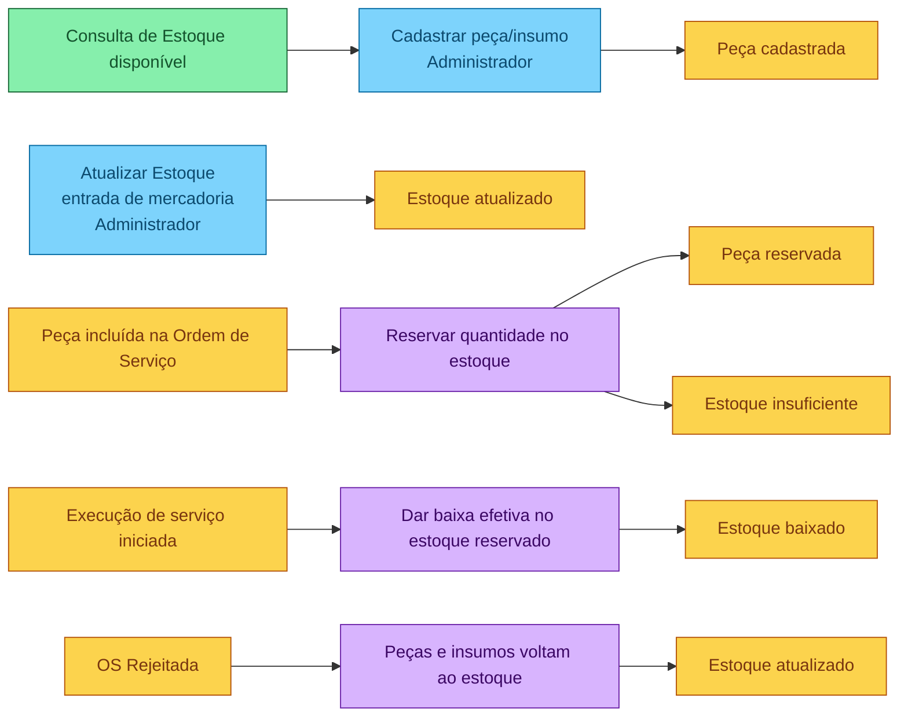

# Event Storming — Gestão de Peças e Insumos

Quadro da imagem `gestao-pecas.png`.

Legenda: azul é comando, laranja é evento, roxo é política e verde é modelo de leitura. O ator fica no post-it amarelo do comando. As políticas não têm ator: reagem ao evento à esquerda.

## Cadastro e entrada

| Tipo | Rótulo | Ator | Encadeamento |
|---|---|---|---|
| Modelo de leitura | Consulta de Estoque disponível | | → Cadastrar peça/insumo |
| Comando | Cadastrar peça/insumo | Administrador | → Peça cadastrada |
| Evento | Peça cadastrada | | fim deste trecho |
| Comando | Atualizar Estoque (entrada de mercadoria) | Administrador | → Estoque atualizado |
| Evento | Estoque atualizado | | fim da entrada |

## Reserva, baixa e devolução

| Tipo | Rótulo | Ator | Encadeamento |
|---|---|---|---|
| Evento | Peça incluída na Ordem de Serviço | | dispara a reserva |
| Política | Reservar quantidade no estoque | | → Peça reservada ou Estoque insuficiente |
| Evento | Peça reservada | | reserva concluída |
| Evento | Estoque insuficiente | | ramo alternativo da mesma política |
| Evento | Execução de serviço iniciada | | dispara a baixa |
| Política | Dar baixa efetiva no estoque reservado | | → Estoque baixado |
| Evento | Estoque baixado | | fim da baixa |
| Evento | OS Rejeitada | | dispara a devolução |
| Política | Peças e insumos voltam ao estoque | | → Estoque atualizado |
| Evento | Estoque atualizado | | fim da devolução |
