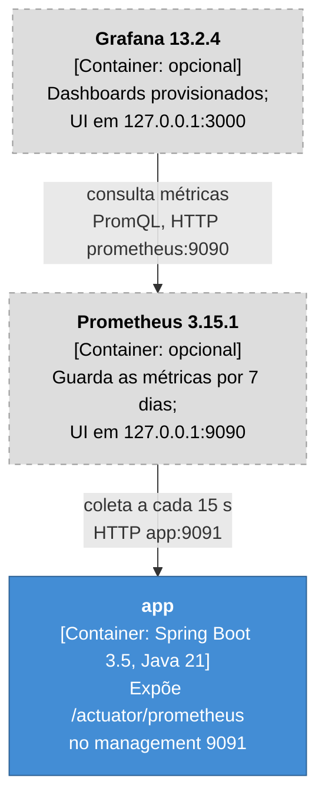

# C4 — Container (nível 2): observabilidade

Mostra como as métricas técnicas da aplicação são coletadas e exibidas: o Prometheus coleta o
`/actuator/prometheus` da `app` no alvo `app:9091` e o Grafana consulta o Prometheus. É a vista de
observabilidade do [C4 de Container](c4-container.md), separada para não poluir o runtime, e ilustra o
[ADR 0016](../adr/0016-metricas-tecnicas-prometheus.md) e o [ADR 0015](../adr/0015-grafana-local-docker.md) (#76/#84, perfil `observability`).
Não mostra o fluxo das requisições, o Keycloak, o MailPit nem o banco: isso está em [c4-container.md](c4-container.md).

Prometheus e Grafana são opcionais e sobem só no perfil `observability` do compose:

```bash
APP_PROFILES=observability docker compose --profile full --profile observability up -d --build
```

Com o perfil `observability` da app, o management vai para a porta `9091`, que não é publicada no
host (ADR 0016). As UIs ficam só em `127.0.0.1`.



Legenda (cores do C4):

| Cor | Tipo de elemento |
|---|---|
| Azul `#438dd5` | Container da oficina |
| Cinza claro `#dddddd`, borda tracejada | Infra opcional (perfil `observability`) |

| De | Para | Relação | Protocolo |
|---|---|---|---|
| Grafana | Prometheus | consulta as métricas (datasource provisionado `oficina-prometheus`) | PromQL por HTTP, `prometheus:9090` |
| Prometheus | app | coleta `/actuator/prometheus` a cada 15 s (`observability/prometheus/prometheus.yml`) | HTTP, `app:9091` |

Com a app rodando no host (`./mvnw spring-boot:run`), o Prometheus usa
`observability/prometheus/prometheus-local.yml` e coleta `host.docker.internal:9091`.
