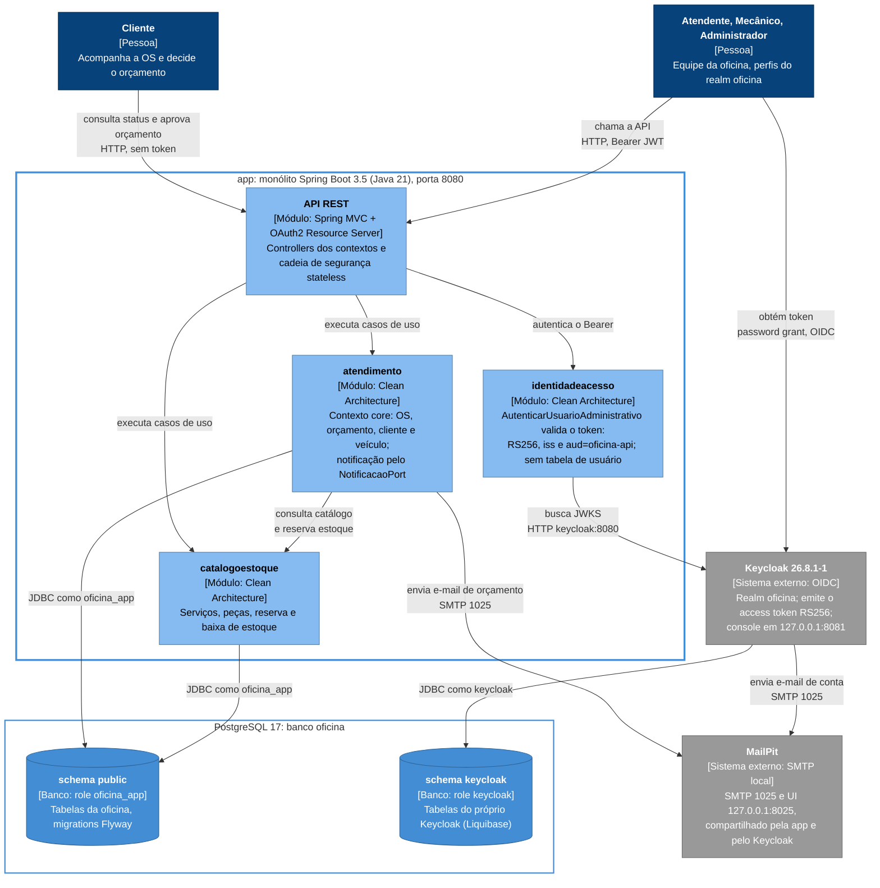

# C4 — Container (nível 2): runtime da requisição autenticada

Decisões: [ADR 0002](../adr/0002-postgres-for-everything.md), [ADR 0006](../adr/0006-keycloak-autenticacao-autorizacao.md), [ADR 0007](../adr/0007-notificacoes-smtp-local.md), [ADR 0016](../adr/0016-metricas-tecnicas-prometheus.md), [ADR 0017](../adr/0017-notificacao-orcamento-email.md), [ADR 0019](../adr/0019-integracao-operacional-keycloak.md), [ADR 0020](../adr/0020-isolamento-dados-identidade.md), [ADR 0021](../adr/0021-politica-seguranca-identidade.md).

Banco único `oficina` com dois schemas e duas roles: `public` pertence à role `oficina_app` (app e
Flyway, sem superusuário) e `keycloak` pertence à role `keycloak` (tabelas criadas e migradas pelo
próprio Keycloak). O Postgres dedicado do Keycloak (`keycloak-db`) foi trocado por este banco único
em 2026-10-26 (ADR 0020).

O monólito é um único container (serviço `app` do compose); as caixas dentro dele são módulos
(pacotes por bounded context), mostrados para deixar claro quem fala com o Keycloak, com o banco e
com o MailPit.

A coleta de métricas (Prometheus e Grafana, perfil `observability`) está na vista [Observabilidade](c4-container-observabilidade.md).

Legenda (cores do C4):

| Cor | Tipo de elemento |
|---|---|
| Azul escuro `#08427b` | Pessoa |
| Borda azul grossa | Container `app` (monólito Spring Boot) |
| Azul bem claro `#85bbf0` | Módulo do monólito (pacote por bounded context) |
| Azul `#438dd5`, cilindro | Schema do banco `oficina` |
| Cinza `#999999` | Sistema externo |
| Borda azul fina | Banco `oficina` (PostgreSQL 17) com os dois schemas |

Keycloak, MailPit e PostgreSQL são serviços do Docker Compose (perfis `dev` e `full`); a fronteira do
compose ficou fora do desenho porque empurrava esses serviços para a direita e dobrava a largura.
O job one-shot `postgres-init` (psql com `keycloak/postgres-init.sql`) cria as roles `oficina_app` e
`keycloak` e o schema `keycloak` antes da app e do Keycloak; ficou fora do desenho para não poluir e
está na tabela abaixo.

### Relações

| De | Para | Relação | Protocolo |
|---|---|---|---|
| Cliente | API REST | consulta a OS e aprova ou rejeita o orçamento (rotas públicas de `/api/acompanhamento`) | HTTP, sem token |
| Equipe | Keycloak | obtém o access token (client público `oficina-api`) | OIDC, password grant (demo local) |
| Equipe | API REST | chama as rotas administrativas | HTTP, Bearer JWT |
| API REST | identidadeacesso | o Resource Server delega a autenticação ao caso de uso `AutenticarUsuarioAdministrativo` | chamada em processo |
| API REST | atendimento, catalogoestoque | executa os casos de uso dos controllers | chamada em processo |
| atendimento | catalogoestoque | consulta serviços e peças e reserva estoque para a OS ([ADR 0014](../adr/0014-integracao-atendimento-catalogo-estoque.md)) | chamada em processo (adapters de integração) |
| identidadeacesso | Keycloak | busca as chaves públicas; o `iss` esperado é `http://localhost:8081/realms/oficina` | JWKS por HTTP interno, `keycloak:8080` |
| atendimento, catalogoestoque | schema `public` | lê e grava via JPA; o Flyway migra na subida | JDBC como `oficina_app` |
| atendimento | MailPit | envia o e-mail de orçamento pelo `NotificacaoPort` (#82, ADR 0017) | SMTP `mailpit:1025` |
| Keycloak | schema `keycloak` | persiste realm, contas e perfis; migra com o Liquibase dele | JDBC como `keycloak` |
| Keycloak | MailPit | envia e-mails de ação de conta | SMTP `mailpit:1025` |
| postgres-init | banco `oficina` | cria as roles `oficina_app` e `keycloak` e o schema `keycloak`, antes da app e do Keycloak | psql, job one-shot |

O `identidadeacesso` não acessa o banco: a identidade é montada por requisição a partir do token.
