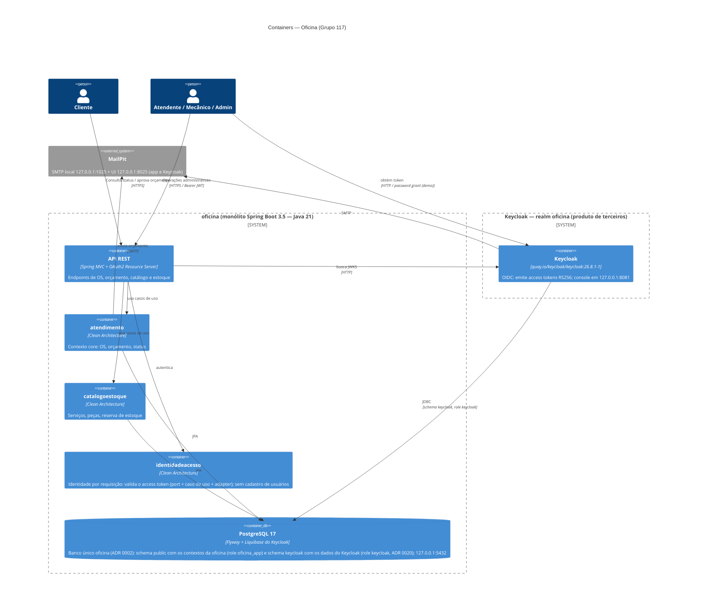

# C4 — Container

Decisões: [ADR 0006](../adr/0006-keycloak-autenticacao-autorizacao.md), [ADR 0019](../adr/0019-integracao-operacional-keycloak.md), [ADR 0020](../adr/0020-isolamento-dados-identidade.md), [ADR 0021](../adr/0021-politica-seguranca-identidade.md).

Banco único `oficina` ([ADR 0002](../adr/0002-postgres-for-everything.md)), com dois schemas e duas roles:
o schema `public` guarda os contextos da oficina e pertence à role `oficina_app` (app e Flyway, sem
superusuário); o schema `keycloak` guarda os dados do Keycloak e pertence à role `keycloak`.
Nota: o Postgres dedicado do Keycloak (`keycloak-db`) foi trocado por este banco único em 2026-10-26,
por decisão do time (ADR 0020). O MailPit é o SMTP local compartilhado pela aplicação (notificação
de orçamento, [ADR 0017](../adr/0017-notificacao-orcamento-email.md)) e pelo Keycloak (e-mails de ação de conta).

