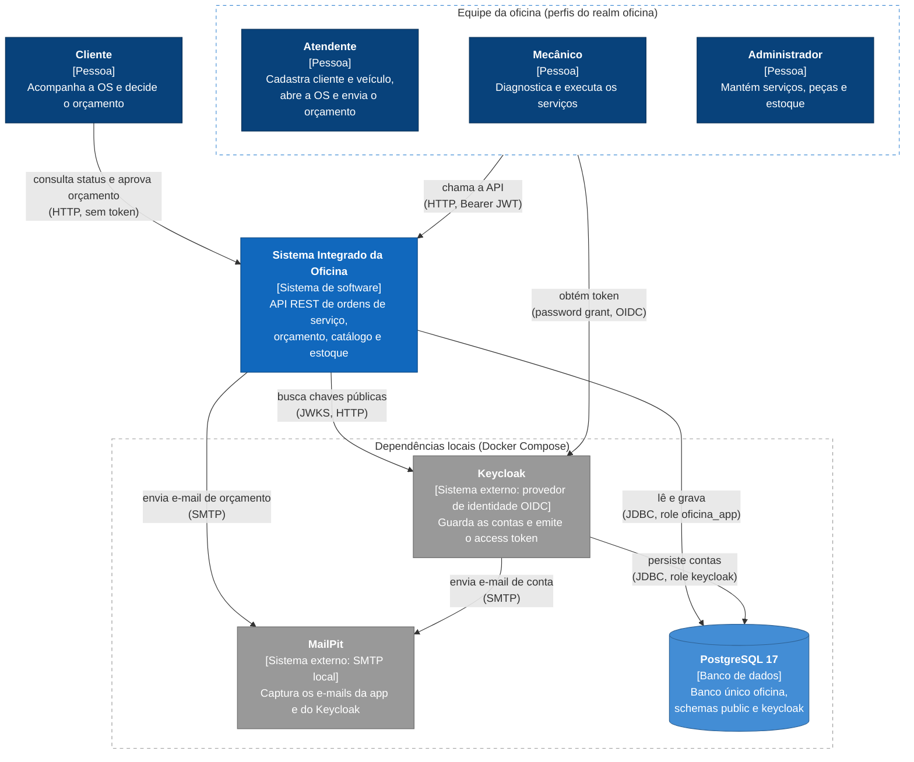

# C4 — System Context (nível 1)

Sistema Integrado de Atendimento e Execução de Serviços da oficina.

Decisões: [ADR 0002](../adr/0002-postgres-for-everything.md), [ADR 0006](../adr/0006-keycloak-autenticacao-autorizacao.md), [ADR 0007](../adr/0007-notificacoes-smtp-local.md), [ADR 0017](../adr/0017-notificacao-orcamento-email.md), [ADR 0019](../adr/0019-integracao-operacional-keycloak.md), [ADR 0020](../adr/0020-isolamento-dados-identidade.md), [ADR 0021](../adr/0021-politica-seguranca-identidade.md).

O sistema da oficina aparece como uma caixa só; o que existe dentro dele está no
[C4 de Container](c4-container.md). O PostgreSQL aparece neste nível porque é compartilhado:
guarda os dados da oficina e, em schema próprio, os do Keycloak (ADR 0020).

Legenda (cores do C4):

| Cor | Tipo de elemento |
|---|---|
| Azul escuro `#08427b` | Pessoa |
| Azul `#1168bd` | Sistema interno (o sistema da oficina) |
| Azul claro `#438dd5`, cilindro | Banco de dados |
| Cinza `#999999` | Sistema externo |
| Borda tracejada | Fronteira: equipe da oficina ou serviços do compose |

### Relações

| De | Para | Relação | Protocolo |
|---|---|---|---|
| Cliente | Oficina | consulta o status da OS e aprova ou rejeita o orçamento pelo identificador da OS | HTTP, sem token (rotas públicas de `/api/acompanhamento`) |
| Atendente, Mecânico, Administrador | Keycloak | obtém o access token no realm `oficina`, client público `oficina-api` | OIDC, password grant (demo local) |
| Atendente, Mecânico, Administrador | Oficina | chama as rotas administrativas | HTTP, `Authorization: Bearer <JWT>` |
| Oficina | Keycloak | busca as chaves públicas para validar a assinatura RS256 | JWKS por HTTP |
| Oficina | MailPit | envia o e-mail de orçamento ao cliente (`NotificacaoPort`, #82) | SMTP |
| Oficina | PostgreSQL | lê e grava os dados da oficina no schema `public` | JDBC, role `oficina_app` |
| Keycloak | MailPit | envia e-mails de ação de conta | SMTP |
| Keycloak | PostgreSQL | persiste o realm, as contas e os perfis no schema `keycloak` | JDBC, role `keycloak` |

Notas:

- Os perfis `ATENDENTE`, `MECANICO` e `ADMINISTRADOR` são realm roles do Keycloak; a oficina não
  tem tabela de usuário. Contas e perfis são mantidos no console do Keycloak (`127.0.0.1:8081`),
  com o admin do realm `master`.
- No ambiente local o MailPit só captura as mensagens (UI em `127.0.0.1:8025`); nada sai para a internet.
- A API é publicada em HTTP na porta `8080` pelo compose; não há TLS no ambiente local.
