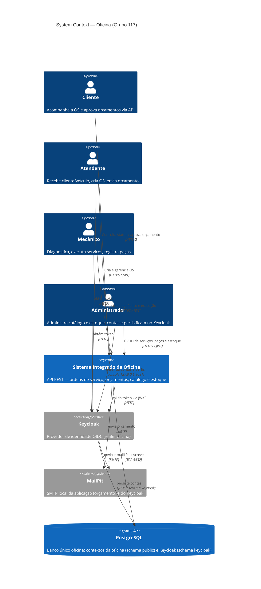

# C4 — System Context

Sistema Integrado de Atendimento e Execução de Serviços da oficina.

Decisões: [ADR 0006](../adr/0006-keycloak-autenticacao-autorizacao.md), [ADR 0019](../adr/0019-integracao-operacional-keycloak.md), [ADR 0020](../adr/0020-isolamento-dados-identidade.md), [ADR 0021](../adr/0021-politica-seguranca-identidade.md).

