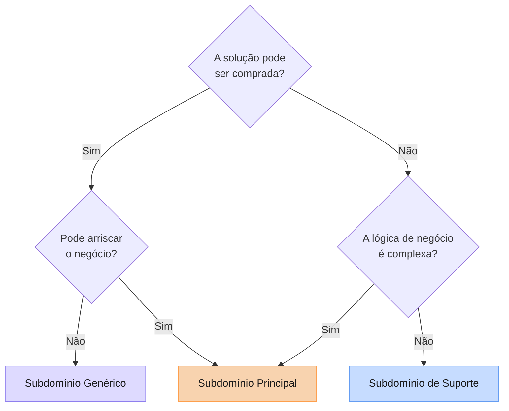

# Diagramas DDD — Critério de classificação de subdomínios

Este fluxograma é o critério usado para classificar cada subdomínio da oficina em Principal, Suporte
ou Genérico. O resultado está na tabela "Classificação e justificativa" de [ddd-subdominios.md](ddd-subdominios.md),
de onde este diagrama foi separado (um diagrama por arquivo).
Exemplos: Identidade e Acesso dá **Genérico**, porque a solução pode ser comprada (Keycloak, [ADR 0006](../adr/0006-keycloak-autenticacao-autorizacao.md))
e não arrisca o negócio; Gestão de Ordens de Serviço dá **Principal**, porque não se compra pronta e a lógica de negócio é complexa.
Fonte: Vlad Khononov, *Learning Domain-Driven Design* (O'Reilly, 2021), como apresentado na Aula 1 (Introdução ao DDD) do curso.
Não mostra os subdomínios da oficina nem a justificativa de cada um: veja o diagrama e a tabela em [ddd-subdominios.md](ddd-subdominios.md).

Fluxograma de Vlad Khononov (Aula 1 — Introdução ao DDD):

